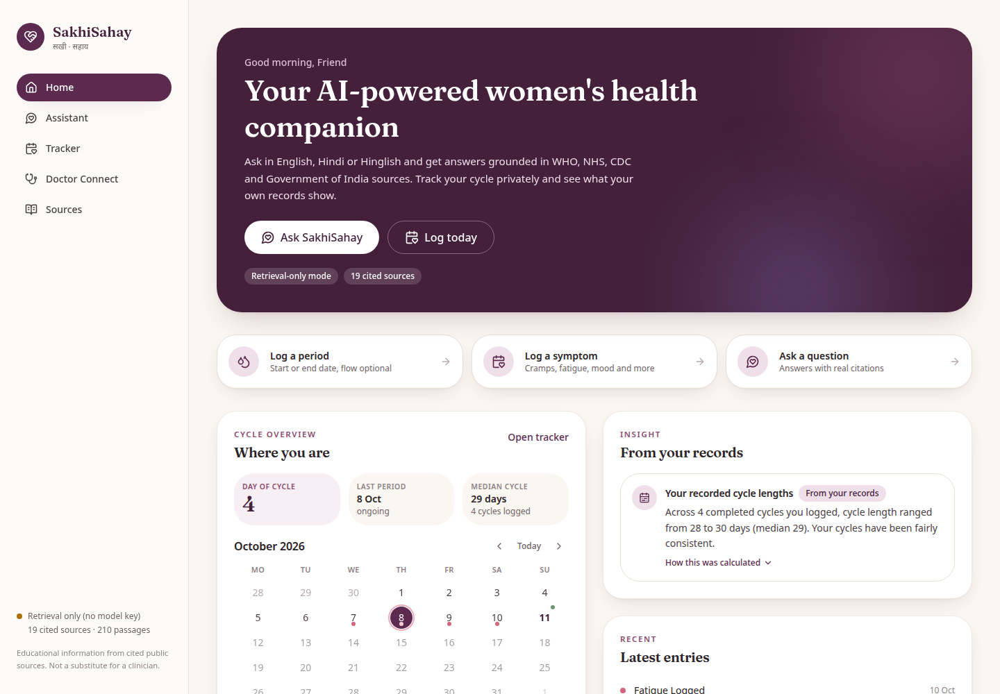

# SakhiSahay

**Your AI-powered women's health companion.**

*Sakhi* (friend) + *Sahay* (support). SakhiSahay is a B.Tech CSE (AI & Data Science) major project:
a multilingual, source-grounded women's health platform that combines

- an **AI health assistant** built on retrieval-augmented generation over verified WHO / NHS / CDC / Government of India material, answering in **English, Hindi or Hinglish** with real, inspectable citations;
- a **menstrual and symptom tracker** with persistent records, history and a calendar;
- **descriptive insights** computed only from the user's own records, each one explaining how it was calculated;
- a clearly labelled **Doctor Connect preview** that shows the planned path to professional care.

Product flow: **Ask -> Understand -> Track -> Analyze -> Escalate when appropriate -> Consult.**

> Status: **mid-semester MVP**. Working end to end in local single-user mode. See
> [docs/roadmap.md](docs/roadmap.md) for what comes next and the Limitations section below for what this is not.



## What works today

| Area | Status |
|------|--------|
| Knowledge ingestion (19 verified sources, 210 passages, metadata + access dates) | Working, reproducible offline from committed snapshots |
| Multilingual semantic retrieval (`intfloat/multilingual-e5-small`, embedded Qdrant) | Working - Hit@6 33/33, MRR 0.896 on the 37-question dev set ([details](docs/evaluation/retrieval-multilingual-e5-small.md)) |
| Grounded answer generation (Gemini `gemini-3.8-flash`, configurable) | Working when `GEMINI_API_KEY` is set; honest `retrieval_only` fallback otherwise |
| Citation validation (markers and URLs checked against retrieved passages) | Working, unit-tested |
| Safety screening (urgent / advisory notices in EN, HI, Hinglish) | Working, keyword-based, unit-tested |
| Period and symptom logging, edit, delete, overlap/date validation | Working, persisted in SQLite, per-user isolation tested |
| Cycle history, calendar, statistics | Working |
| Descriptive insights (cycle length, duration, symptom-per-cycle, recent symptom days, NHS-cited guidance notes) | Working, emitted only when data supports them |
| Dashboard, Assistant, Tracker, Doctor Connect preview, Sources pages, responsive layout | Working |
| Authentication, real doctors/bookings, cycle prediction, PostgreSQL, deployment | **Not yet** (Phases 2-6) |

## Quick start

Prerequisites: Python 3.12, Node 22 with `pnpm` (or npm), about 2 GB of disk for CPU PyTorch and the embedding model, internet for the first run.

### 1. Backend

```bash
cd backend
python3 -m venv .venv && source .venv/bin/activate      # or: uv venv .venv
pip install torch --index-url https://download.pytorch.org/whl/cpu   # CPU-only wheel, avoids multi-GB CUDA downloads
pip install -r requirements.txt

cp ../.env.example .env            # then put your Gemini key in GEMINI_API_KEY
python -m app.knowledge.ingest --offline   # builds the vector index from committed text snapshots (~1 min, downloads the embedding model once)
uvicorn app.main:app --reload --port 8000
```

- `--offline` uses the committed extracted-text snapshots so the demo index is reproducible without network access.
  Drop the flag to re-fetch from the publishers (cached, polite 1 s delay), or add `--refresh` to force re-download.
- Without `GEMINI_API_KEY` the assistant still works in **retrieval-only mode** and the UI says so.
- The embedded Qdrant store is single-process: stop the API before running ingestion or the evaluation script.

API docs: http://127.0.0.1:8000/docs

### 2. Frontend

```bash
cd frontend
pnpm install
pnpm dev          # http://127.0.0.1:5173 (proxies /api to the backend)
```

### 3. Tests and evaluation

```bash
cd backend
.venv/bin/python -m pytest -q                        # 25 tests, < 1 s
.venv/bin/python -m evaluation.run_retrieval_eval    # retrieval metrics -> docs/evaluation/
.venv/bin/python -m evaluation.run_retrieval_eval --with-answers   # also runs the full pipeline (needs a Gemini key) for manual review
cd ../frontend && pnpm typecheck && pnpm build
```

## Configuration

All configuration is via environment variables (see [.env.example](.env.example)). Never commit `.env`.

| Variable | Purpose | Default |
|----------|---------|---------|
| `LLM_PROVIDER` | `gemini` or `none` | `gemini` |
| `GEMINI_API_KEY` | Google AI Studio key (read from env only) | empty -> retrieval-only mode |
| `GEMINI_MODEL` | model id | `gemini-3.8-flash` |
| `EMBEDDING_MODEL` | any sentence-transformers id | `intfloat/multilingual-e5-small` |
| `QDRANT_PATH` / `QDRANT_URL` | embedded store path, or a server URL | embedded `./data/runtime/qdrant` |
| `RETRIEVAL_TOP_K`, `RETRIEVAL_MIN_SCORE*` | retrieval depth and per-language relevance gates | 6; en 0.83 / hinglish 0.80 / hi 0.78 |
| `DATABASE_URL` | SQLAlchemy URL | SQLite `./data/runtime/sakhisahay.db` |
| `AUTH_MODE` | `local` (single seeded user) | `local` |

## Repository layout

```
backend/
  app/
    api/          FastAPI routers: chat, tracker, insights, knowledge, doctors (demo), health
    db/           SQLAlchemy models (users, period_records, symptom_records, knowledge_sources), session, init
    knowledge/    manifest -> acquire -> extract (trafilatura / PyMuPDF) -> chunk -> ingest CLI
    rag/          language, embeddings, vector_store, retriever, prompt_builder, llm/, citations, safety, pipeline
    schemas/      Pydantic request/response models
    services/     tracker_service, insights_service (descriptive statistics)
  data/knowledge/ sources.yaml (manifest) + cache/ (committed text snapshots and extraction reports)
  evaluation/     eval_questions.yaml (37 EN/HI/Hinglish questions) + run_retrieval_eval.py
  tests/          pytest suite
frontend/
  src/components  design-system primitives (Button, Card, Badge, Field, Dialog, Toast, Notice, EmptyState) + layout
  src/features    dashboard, assistant, tracker, doctors, sources
  src/styles      design tokens (Tailwind v4 @theme) and base styles
docs/             architecture, roadmap, knowledge sources & research, evaluation results, demo script, screenshots
```

## Architecture in one paragraph

A React + TypeScript + Vite + Tailwind v4 frontend talks to a FastAPI backend. Personal health records live in a
relational database (SQLite now, PostgreSQL later) and never enter the vector database. Public knowledge is ingested
by a separate CLI into an embedded Qdrant collection with full source metadata on every chunk. A chat request is
screened for urgent phrases, language-detected, embedded with a multilingual model, matched against the collection,
gated on similarity (per language), turned into a prompt that contains only retrieved evidence (plus, optionally and
with per-request consent, a numeric summary of the user's own tracker records), answered by Gemini, and then every
citation marker and URL in the answer is validated against what was actually retrieved. Full details and diagrams:
[docs/architecture.md](docs/architecture.md).

## Privacy and safety posture (honest version)

- Records are isolated per user at the query layer and tested; but there is **no login yet** (single local user).
- Logs contain counts, modes and timings - never question text, answers, notes or symptom histories.
- The assistant cannot cite anything outside [the source list](backend/data/knowledge/sources.yaml); invalid citations are stripped.
- Safety screening is keyword-based and limited; it adds notices, it does not "understand" the situation.
- Insights are descriptive statistics with their basis shown; nothing diagnoses or predicts.
- This prototype is **not** clinically validated, not production-hardened, and not compliant with any regulation.

## Limitations (mid-semester)

- Generation quality in Hindi/Hinglish and the safety-probe answers have **not** been evaluated in CI because the build
  environment had no Gemini key; `run_retrieval_eval.py --with-answers` produces the transcript for manual review.
- Relevance gates were calibrated on the same 37 questions they are reported on; a held-out set is Phase 2 work.
- 19 sources is a deliberately small, curated corpus. The NHM policy PDF text was captured through an external fetch
  because nhm.gov.in timed out from the build machine (recorded transparently in its `.meta.json`).
- No authentication, no PostgreSQL, no deployment, no cycle prediction, no real clinicians - all scheduled in the roadmap.

## Documentation

- [docs/architecture.md](docs/architecture.md) - system, RAG, data model, privacy architecture
- [docs/knowledge-sources.md](docs/knowledge-sources.md) - source manifest, verification and licensing notes, tracker research (Flo/Clue), medical reference rules
- [docs/evaluation/](docs/evaluation/) - metric definitions and actual results
- [docs/roadmap.md](docs/roadmap.md) - Phases 2-6 to the final project
- [docs/demo-script.md](docs/demo-script.md) - mid-semester demonstration sequence and fallbacks

## Attribution

Knowledge content is reproduced for non-commercial academic use with attribution from the World Health Organization
(publications under CC BY-NC-SA 3.0 IGO), the NHS website, the US CDC (public domain) and the National Health Mission,
Ministry of Health & Family Welfare, Government of India. Full per-source notes are in the manifest. SakhiSahay is not
affiliated with or endorsed by any of these organisations.
