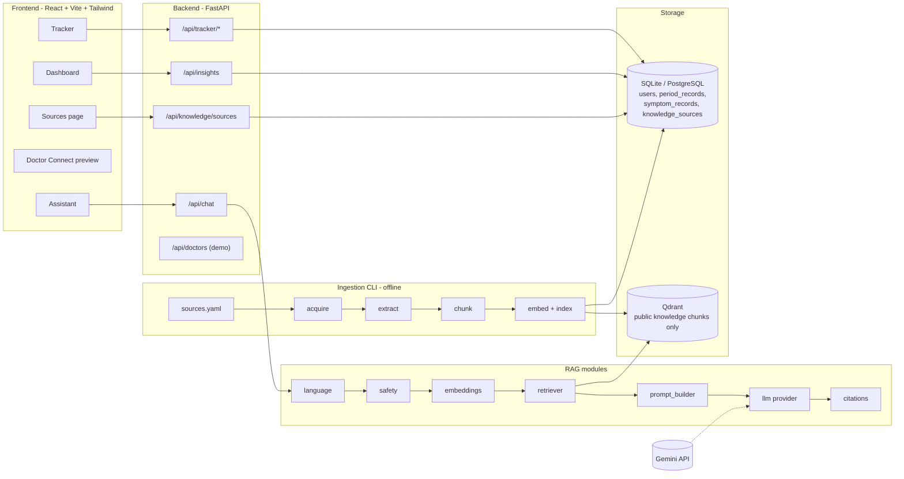
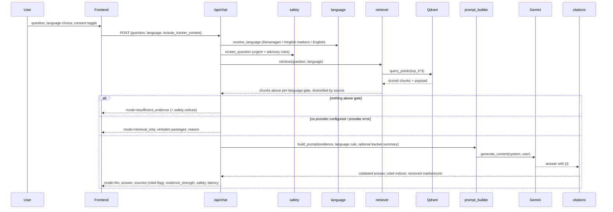
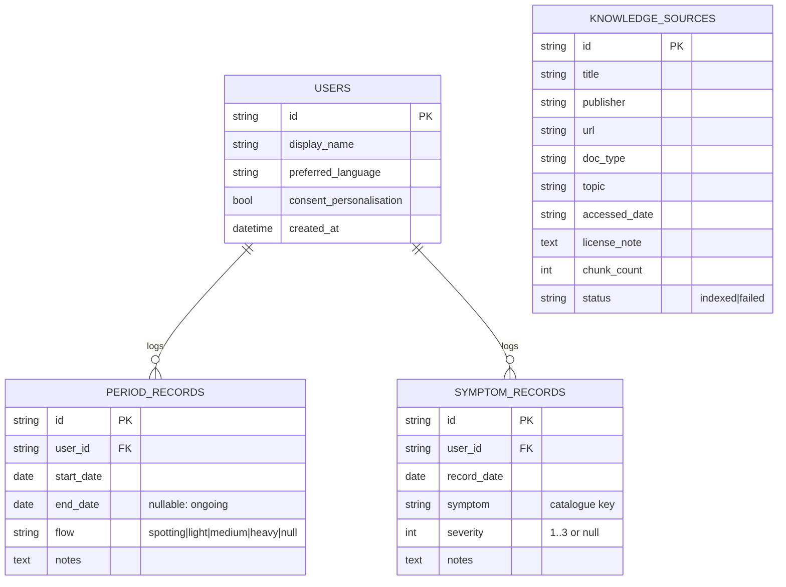

# SakhiSahay - Architecture

## 1. System overview

Design rules that shaped this:

- **Separation of ingestion from serving.** Ingestion is a CLI that can run on a different machine and time; the chat
  path only reads the index.
- **Two stores, never mixed.** Personal records are relational and per-user; the vector database holds only public
  knowledge. Personal context reaches the model only as a numeric summary, per request, with consent.
- **Each RAG responsibility is a module** (`app/rag/*`). `pipeline.py` is 150 lines of orchestration, nothing more.
- **Honest modes.** The API returns `mode = llm | retrieval_only | insufficient_evidence` and the UI labels each.

## 2. Request lifecycle for a question

## 3. Retrieval details

| Item | Choice | Why |
|------|--------|-----|
| Embedding model | `intfloat/multilingual-e5-small` (384-d, 118M params, MIT) | small enough for CPU laptops, strong cross-lingual behaviour; `query:`/`passage:` prefixes applied automatically |
| Alternative evaluated by config | `paraphrase-multilingual-MiniLM-L12-v2` (Apache-2.0) | swap `EMBEDDING_MODEL`, re-run ingest and the eval script to compare |
| Vector store | Qdrant embedded (`path=`) now; `QDRANT_URL` for a server later | identical client API in both modes |
| Chunking | heading-aware, ~1100 chars max, tiny fragments carried forward | keeps WHO/NHS sections intact and inside the 512-token window |
| Diversification | max 2 chunks per source in the final top-k | citations span documents instead of six paragraphs of one page |
| Relevance gate | cosine >= 0.83 (en) / 0.80 (hinglish) / 0.78 (hi) | e5 scores are compressed and cross-lingual queries land ~0.05 lower; calibrated on the dev set |
| Evidence strength | gate+0.06 strong, gate+0.02 moderate, else weak | shown to users so uncertainty is visible |

## 4. Prompting and citation integrity

- The system prompt fixes the role (educational, no diagnosis, no medication decisions, cite only given `[S#]`,
  answer in the requested language, include warning signs when the evidence has them).
- Evidence is numbered; each block carries publisher, title and section so the model can refer to them naturally.
- After generation, `citations.validate_citations` strips markers outside the evidence range and replaces URLs that
  are not among retrieved source URLs. The returned `sources` array is built from retrieved chunks, never from model
  text, and each entry carries a `cited` flag.
- If the model cites nothing, the response says so (`fallback_reason`) and lists all retrieved sources.

## 5. Safety layer

`app/rag/safety.py` runs before retrieval and independently of the model:

- **Urgent** rules (EN/HI/Hinglish): very heavy bleeding, fainting/collapse, bleeding or severe pain in pregnancy,
  severe pain unrelieved by painkillers, self-harm. Each produces an NHS-referenced notice rendered as a red alert
  above the answer (and a government helpline for self-harm).
- **Advisory** rules: diagnosis requests, medication/dose requests. Rendered as amber notes below the answer.
- Limits: keyword matching, no negation handling, no severity inference. Documented as such in the UI copy.

## 6. Data model

Rules enforced in code: no future dates; `end_date >= start_date`; a period record spans at most 31 days; period
records of one user may not overlap; symptom keys come from a configurable catalogue; notes capped at 500 chars;
`ON DELETE CASCADE` from users; indexes on `(user_id, start_date)` and `(user_id, record_date)`.

Vector payload per chunk: `chunk_id, source_id, title, publisher, url, doc_type, topic, section, language,
published_date, updated_date, accessed_date, license_note, text`.

## 7. Insights (Module D, descriptive only)

`services/insights_service.py` computes:

- cycle lengths = gaps between consecutive logged start dates (needs 3 periods), with spread-based wording;
- period duration from records with end dates (needs 2);
- symptom-per-cycle frequency over the last 5 completed cycles (needs 4 periods, counts cycles not entries);
- distinct symptom days in the last 90 days (needs 3 days), with a severe-day count;
- **guidance** notes only when recorded values leave the NHS reference ranges (21-35 day cycles, <= 7 day periods),
  phrased as general information with a link, never as an assessment.

Every insight carries `basis` (the exact numbers used) and `records_used`; unmet thresholds are returned as
`requirements` so the UI can show what unlocks more instead of fabricating.

## 8. Privacy architecture

| Concern | Now (MVP) | Before real users |
|---------|-----------|-------------------|
| Identity | single seeded local user; `X-User-Id` header only for isolation tests | JWT auth, password hashing, sessions |
| Isolation | every tracker/insight query filtered by `user_id`; tested | same, plus row-level policies in PostgreSQL |
| Personalisation | per-request checkbox; numeric summary only; nothing stored | stored consent record with timestamp and scope, revocation |
| Logging | counts, modes, timings only | structured logs with redaction, retention policy |
| Deletion | per-entry and delete-all endpoints | account deletion, export (JSON/PDF) |
| Secrets | env vars, `.env` git-ignored, `.env.example` without values | secret manager in deployment |
| Transport | localhost | HTTPS, HSTS, CORS allow-list |

## 9. Frontend architecture

- Design tokens in `src/styles/globals.css` (Tailwind v4 `@theme`): ivory surfaces, plum primary, lavender
  secondary, rose accent, sage success, amber caution, danger red; Fraunces display face, Noto Sans body with
  Noto Sans Devanagari fallback so Hindi renders without layout shifts.
- Primitives in `src/components/ui`; feature folders own their screens and hooks; `@tanstack/react-query` handles
  caching and invalidation after mutations; `react-router-dom` for routes; `react-markdown` for answers with a custom
  link renderer that turns `[S#]` markers into citation chips.
- Accessibility: semantic landmarks, `role=radiogroup` language selector, `aria-pressed` chips, `role=alert` for
  urgent notices, visible focus ring token, reduced-motion media query, 44 px touch targets on mobile, text labels
  alongside every colour cue in the calendar legend.
